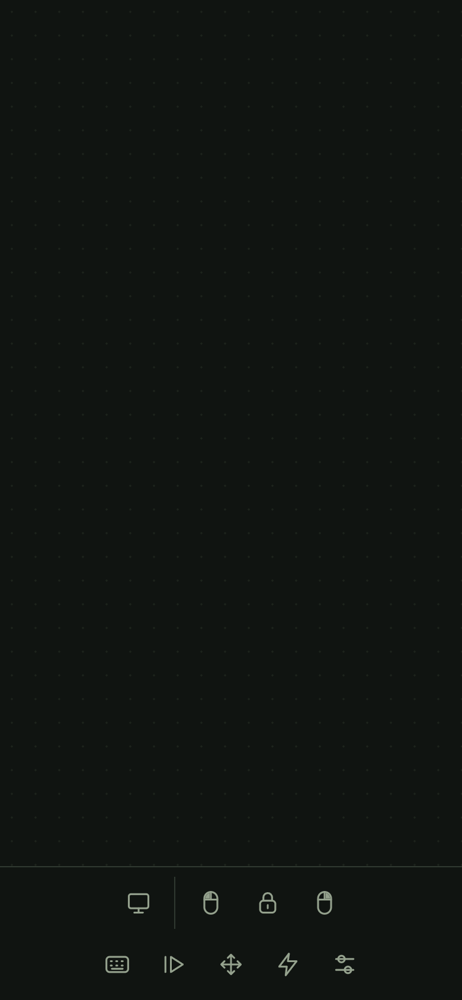
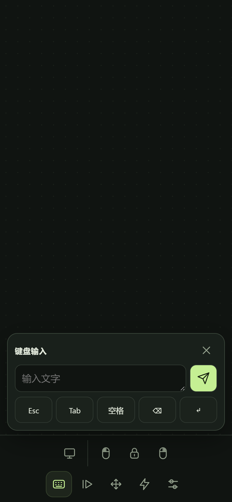
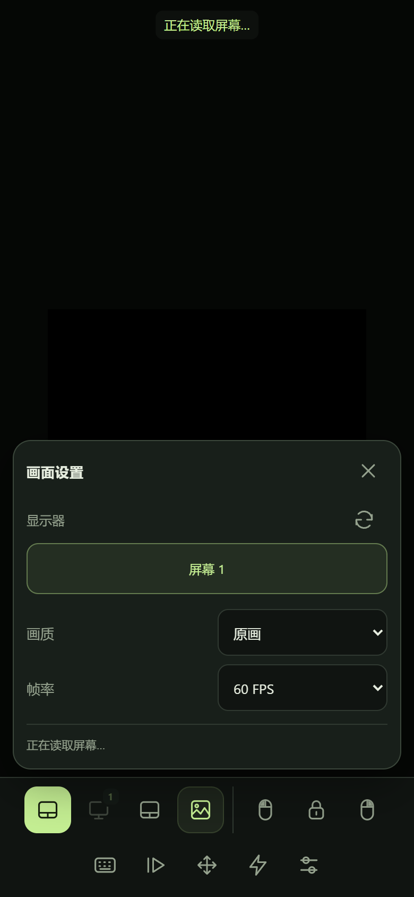
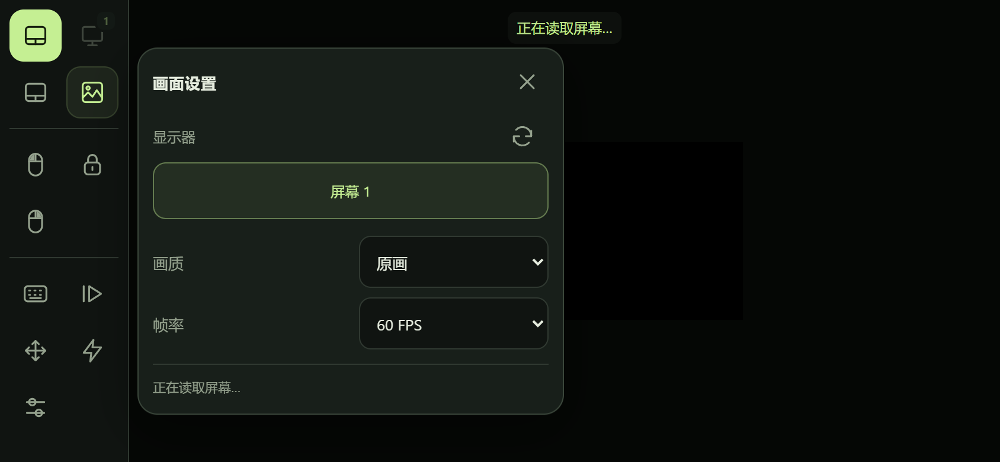

<div align="center">
  
  <h1>Palm Remote · 掌上遥控</h1>
  <p>用手机或平板通过局域网控制 Windows 10/11 桌面。<br />
  Turn your phone or tablet into a low-latency trackpad, screen and keyboard for Windows.</p>

  <p>
    
    
    
    
  </p>
</div>

---

Palm Remote 是一个面向局域网的 Windows 远程控制 Web 应用。手机或平板无需安装客户端，通过浏览器即可获得触控板、实时桌面、键盘、媒体键和快捷键控制，并可作为 PWA 添加到主屏幕。

## 截图

<table>
  <tr>
    <td align="center"><br /><sub>触控板模式</sub></td>
    <td align="center"><br /><sub>键盘输入与快捷键</sub></td>
    <td align="center"><br /><sub>画质与帧率设置</sub></td>
  </tr>
  <tr>
    <td colspan="3" align="center"><br /><sub>横屏时画面在左、控制面板在右</sub></td>
  </tr>
</table>

## 功能特性

- **实时桌面**：DXGI Desktop Duplication → NVIDIA NVENC H.264 → WebCodecs 连续视频流，低延迟传输。
- **两种操控方式**：手机适合相对移动触控板，平板适合“指哪打哪”的绝对定位。
- **完整鼠标操作**：单击、双击、长按拖动、双指滚动、右键、左右键和拖动锁定。
- **多显示器切换**：自动检测屏幕，支持运行中刷新显示器列表。
- **键盘与快捷键**：文字输入、方向键、媒体键、复制/粘贴/撤销/切换窗口等常用快捷键。
- **画面调节**：原画 / 高清 1440p / 清晰 1080p / 流畅 720p，15 / 30 / 60 FPS 上限，设置保存在浏览器。
- **PWA 支持**：通过 HTTPS 安装到主屏幕，离线缓存应用外壳。
- **单控制端保护**：同一时间只允许一台设备连接，保留同源校验、心跳超时释放和消息限流。
- **只走局域网**：无云端中转，不传输声音，不依赖外部账号或配对服务。

## 系统要求

| 项目 | 要求 |
| --- | --- |
| 服务端 | Windows 10 / 11，交互式桌面会话 |
| GPU | 支持 NVENC 的 NVIDIA 显卡及可用驱动 |
| Python | 3.11+（高精度帧率定时） |
| 浏览器 | 支持 HTTPS 下 H.264 WebCodecs 的现代浏览器 |
| 网络 | 可信局域网，手机与电脑处于同一子网 |

> 抓屏与输入注入需要交互式桌面，无法控制登录界面、锁屏或 UAC 安全桌面。普通权限无法操作管理员窗口。

## 快速开始

1. 克隆仓库：

   ```powershell
   git clone https://github.com/<your-name>/remote_control.git
   cd remote_control
   ```

2. 运行安装脚本（自动请求 UAC）：

   ```powershell
   powershell -ExecutionPolicy Bypass -File .\remote.ps1
   ```

   脚本会自动创建虚拟环境、安装依赖、生成 HTTPS 证书、配置专用网络本地子网 TCP 8765 防火墙规则，并注册开机登录自启任务。

3. 将 `data/palm-ca.crt` 传到手机并安装信任。**不要传输任何私钥文件。**

   - iPhone：安装后在“设置 → 通用 → 关于本机 → 证书信任设置”中启用完整信任。
   - Android：在系统证书设置中安装 CA 证书。

4. 在手机浏览器访问脚本输出的 `https://电脑IP:8765`，可从浏览器菜单添加到主屏幕。

## 管理命令

唯一入口为 `remote.ps1`。默认执行安装并启动，其他操作通过 `-Action` 指定：

```powershell
.\remote.ps1 -Action Info          # 查看地址与计划任务状态
.\remote.ps1 -Action Start         # 后台启动
.\remote.ps1 -Action Stop          # 停止
.\remote.ps1 -Action Restart       # 重启
.\remote.ps1 -Action Certificate   # 更新证书并重启，保留原 CA
.\remote.ps1 -Action Certificate -IP 192.168.1.100
.\remote.ps1 -Action Uninstall     # 管理员运行：移除任务与防火墙规则，保留数据
.\remote.ps1 -Action Run           # 前台运行，便于排错
```

IP 变化或一年期服务器证书到期时更新证书。日志位于 `data/server.log`，提权安装日志位于 `data/setup.log`。

## 使用说明

- 底部切换 **触控板 / 实时画面**，选择显示器，点击触控板 / 鼠标图标切换操控模式。
- 横屏时画面在左、控制按钮在右；“刷新”重新检测显示器插拔。
- **触控板模式**：单指相对移动，轻点左键，连续轻点双击，长按 420 ms 后拖动，双指滚动或轻点右键。
- **指哪打哪**：触点对应画面坐标，保留长按拖动、双指滚动与右键；画面黑边不会定位，拖动到边缘限制在当前显示器内。
- 切屏、切模式、切后台、断线都会释放拖动。
- 底部提供独立左右键、拖动锁定、文字输入、方向键、媒体键与快捷键。

## 安全说明

本项目按“可信局域网内使用”设计：

- 仅在专用网络本地子网开放 TCP 8765，**不要将端口映射到公网**。
- 无需配对码，但保留同源校验、跨站请求拦截、单控制端限制和心跳超时释放。
- HTTPS 证书、CA 私钥、服务器私钥、配对配置和日志均位于 `data/`，已通过 `.gitignore` 排除，不会提交到仓库。
- 只向手机传输 `data/palm-ca.crt` 公钥证书，**永远不要传输 `*-key.pem` 私钥**。
- 状态接口不包含屏幕内容；实时画面只在已建立的控制连接中传输。

## 性能设计

- 使用 DXGI Desktop Duplication 抓屏，NVIDIA NVENC 硬件编码 H.264，浏览器 WebCodecs 解码。
- 服务端持续推流，采集、传输和解码重叠执行；根据近期解码确认耗时调整在途窗口（2–8 帧、4 MiB 字节阈值）。
- 解码确认不等待页面绘制，页面始终只显示最新一帧已解码画面。
- 关闭 B 帧、前瞻和编码延迟缓冲；使用 High profile、P4 预设和空间自适应量化改善文字细节。
- 缩放使用面积采样避免细线混叠；原画保持显示器分辨率（编码尺寸取偶数），高清最高 1440p，清晰最高 1080p，流畅最高 720p。
- 四档码率上限分别为 40 / 28 / 20 / 8 Mbps，使用帧间压缩降低静态桌面流量。
- `/api/status` 的 `stream` 字段可查看实际绘制 FPS、解码 FPS、码率、解码 / RTT / 确认耗时、在途窗口，以及采集、缩放、色彩转换和编码耗时。
- 使用现有加密 WebSocket / TCP 传输，不增加额外端口；网络丢包仍会受到 TCP 重传影响。

> 4K 桌面缩到 1080p 会不可逆地丢失细小文字细节，需要清晰文字时请选择高清或原画。H.264 4:2:0 仍会影响细小彩色文字，更高码率不等同于无损或 4:4:4。

## 开发与测试

```powershell
# 安装依赖
.venv\Scripts\python.exe -m pip install -r requirements.txt

# 本地 HTTP 开发模式（不注入输入，但会读取桌面）
.venv\Scripts\python.exe -m backend.server --http --dry-run --host 127.0.0.1

# Python 测试
.venv\Scripts\python.exe -m unittest discover -s tests -v

# 前端单元测试
node --test tests/*.test.js

# 可选：使用本机 Edge 验证实时画面与手机 / 平板布局
.venv\Scripts\python.exe -m pip install playwright
.venv\Scripts\python.exe tests/browser_smoke.py
.venv\Scripts\python.exe tests/pwa_update_smoke.py
.venv\Scripts\python.exe tests/video_smoke.py
.venv\Scripts\python.exe tests/video_quality.py
```

`--dry-run` 不注入鼠标键盘输入，但实时画面仍会读取桌面。真实手机多点触控、混合 DPI 多屏与计划任务开机登录启动需要实机验收。

## 项目结构

```text
remote_control/
├─ backend/           # aiohttp 服务、抓屏、NVENC 推流、输入注入与流控
├─ web/               # PWA 前端：触控板、解码、手势、样式与图标
├─ tests/             # Python / Node 单元测试与浏览器冒烟测试
├─ docs/screenshots/  # README 截图
├─ remote.ps1         # 安装、证书、计划任务与自启管理入口
├─ requirements.txt   # Python 依赖
└─ package.json       # 前端测试脚本
```

## 已知限制

- 仅支持 Windows 10/11；抓屏依赖 DXGI，编码依赖 NVIDIA NVENC。
- 需要支持 H.264 WebCodecs 的浏览器；不支持时会明确报错，但触控板和键盘仍可使用。
- 无法控制登录界面、锁屏或 UAC 安全桌面。
- 不传输声音。
- 同一时间只允许一个控制设备。
- 仅在可信局域网使用；公网暴露不在支持范围内。

## 致谢

视频流控和编码参数参考了以下开源项目的公开设计：

- [RustDesk](https://github.com/rustdesk/rustdesk) — 视频 QoS 对延迟基线和拥塞的区分。
- [Sunshine](https://github.com/LizardByte/Sunshine) — NVENC 低延迟、前瞻、量化和码率缓冲配置。

本项目自行实现有界确认窗口和浏览器最新帧显示，不复制上述项目的实现，也不宣称具备其完整原生 GPU 管线。

## 许可证

本项目基于 [MIT License](LICENSE) 开源。
